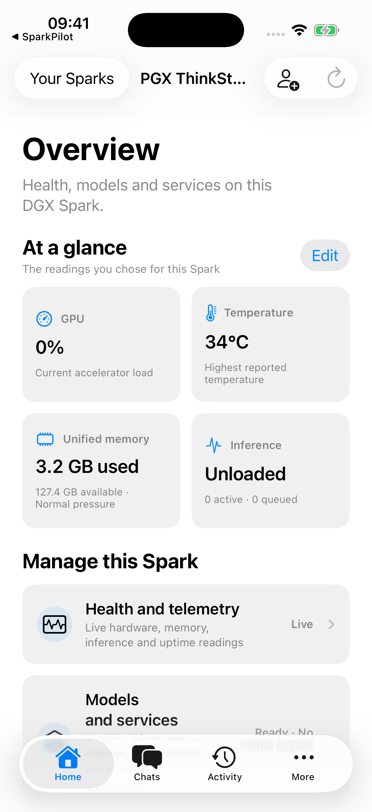
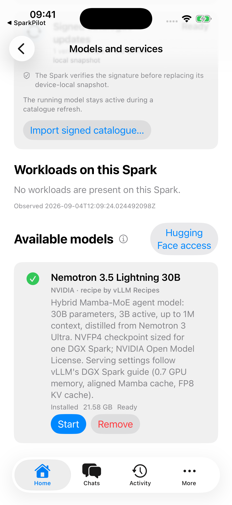
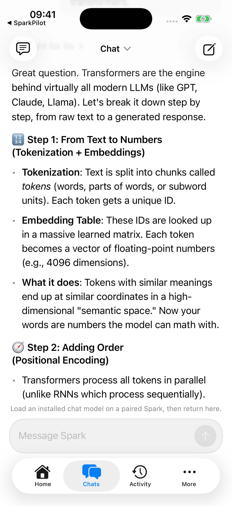
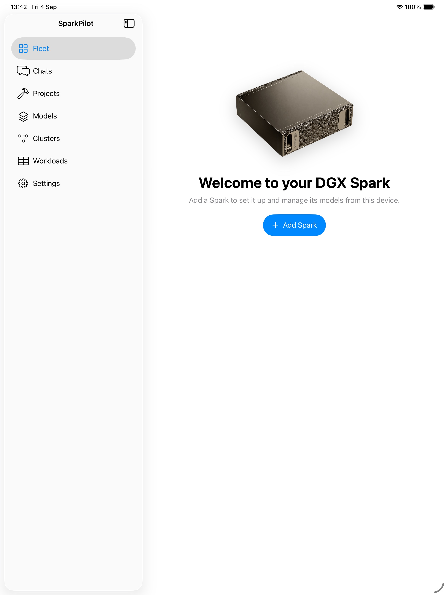

# SparkPilot

Private AI infrastructure that feels like an Apple accessory.

SparkPilot pairs Apple devices with NVIDIA DGX Spark systems for private chat, model management and remote access through the authenticated Spark Runtime. The immediate beta scope is iPhone and iPad with Nemotron Lightning; implemented features, device qualification and future work are tracked separately.

## Screenshots

From the [SparkPilot website](https://sparkpilot.dev/): simulator screenshots from an earlier development build, with captured example content rather than live readings; the current app may look different.

| Spark overview | Models and services | Chat |
| :---: | :---: | :---: |
|  |  |  |

<details>
<summary>See the iPad layout</summary>

<p align="center">
  
</p>

</details>

## Project guide

The API and schemas in `contracts/`, recipes in `recipes/`, and source code define the implementation.
See [CONTRIBUTING.md](CONTRIBUTING.md) for development commands and [SECURITY.md](SECURITY.md) for vulnerability reporting.

## Repository layout

```text
apple/     Universal SwiftUI app: SparkApp + shared Spark* packages
runtime/   Rust workspace: sparkd, spark-privd, and support crates
contracts/ OpenAPI, JSON Schemas, generated contract bindings
recipes/   Signed model and engine recipes, catalogue tooling
packaging/ Debian packaging, systemd units, cloud-init
tests/     Contract, integration, hardware, security, UI suites
tools/     Generate contract bindings, sign releases, validate contracts
docs/      API reference, dependency locks, tooling and screenshots
```

## Developer commands

```sh
just format         # cargo fmt + swift format
just format-check   # full-tree cargo fmt + strict swift format checks
just lint           # cargo clippy -D warnings
just test-runtime   # cargo test --workspace --all-features
just test-contracts # strict OpenAPI validation plus Swift/Rust generation drift
just audit          # pinned cargo-audit against runtime/Cargo.lock
just build-runtime  # cargo build --workspace --release
just ci             # CI gates; Swift lint is scoped to changes from main
```

`just` is a requirement for the canonical command set; the underlying
commands are documented in `Justfile`.

## Non-negotiable boundaries

- `sparkd` is the sole product gateway; vLLM binds to loopback only.
- `spark-privd` accepts only typed, allowlisted operations over a Unix socket.
- Model recipes and engine images are signed and pinned; nothing unpinned loads.
- "Unload" means stop the engine container and verify memory recovery.
- Device request signatures, replay protection, role checks, and audit are
  mandatory on every route, local or remote.
- Tailscale is connectivity, not final authorisation.
- The product does not replace Apple Intelligence globally.

## Status

SparkPilot is in beta, with iPhone and iPad as the current testing focus.
Candidate model recipes may be present for development without being approved for distribution; the catalogue publication checks enforce that distinction.
A successful source build does not establish hardware qualification.

## Licensing

The root [LICENSE](LICENSE) applies to SparkPilot-owned code unless a file declares otherwise.
The Qwen engine adaptation in [packaging/engines/qwen38](packaging/engines/qwen38) includes third-party patches under [AGPL-3.0-or-later](packaging/engines/qwen38/LICENSE), identified by their SPDX headers and pinned upstream source in the Dockerfile.
The vendored [SwiftTerm](apple/Vendor/SwiftTerm/UPSTREAM.md) library retains its [MIT license](apple/Vendor/SwiftTerm/LICENSE).
Dependency and model licenses remain with their respective owners; the root license does not relicense them.
